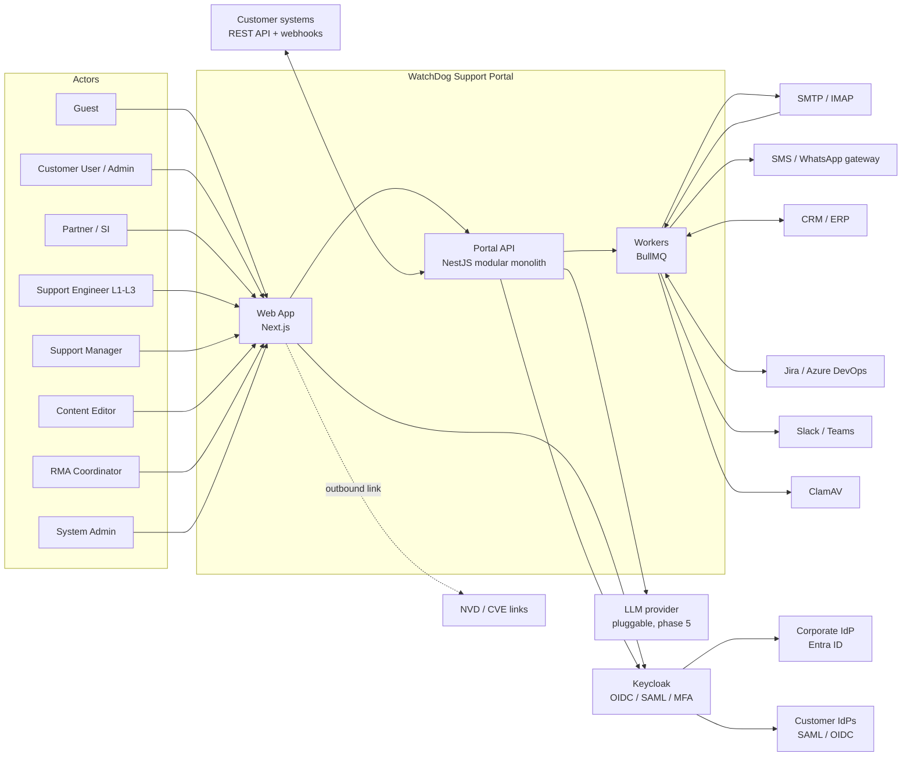
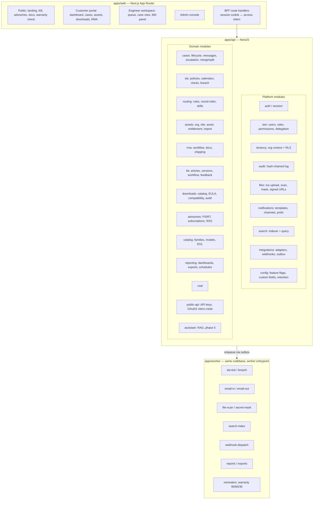
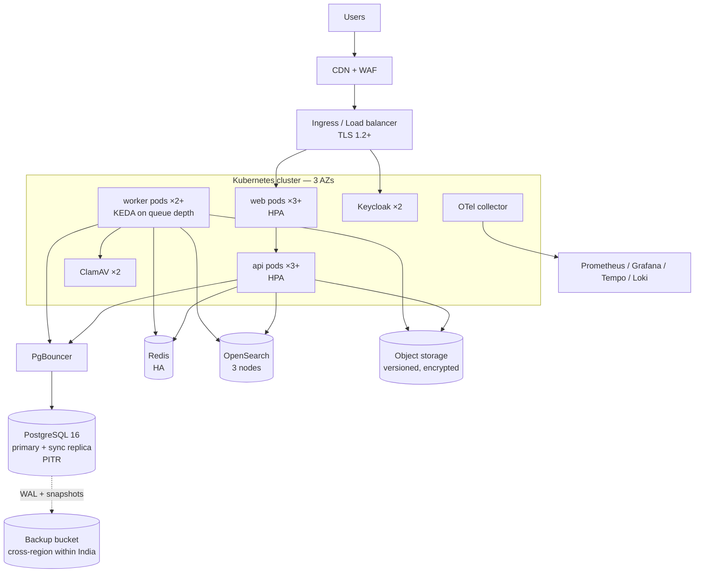

# WatchDog Support Portal — Phase 1 Architecture

| | |
|---|---|
| Status | Draft for review (Phase 1) |
| Date | 2026-11-04 |
| Scope | Architecture, data model, API surface, RBAC, SLA engine, threat model, deployment, delivery plan |
| Companion | `docs/ADR.md` (Architecture Decision Records 001–016) |

> Branding: everything in this repository and every customer-facing surface is "WatchDog". Internal OEM mapping lives only in `product.internal_oem_ref` / `firmware.internal_oem_ref`, which are excluded from every customer-role serializer, search index, export, PDF and log line. A CI "brand-lint" gate enforces this (ADR-012).

---

## 0. Locked assumptions (from Phase 0)

| # | Topic | Assumption |
|---|---|---|
| A1 | Hosting | Primary: public cloud, India region (AWS ap-south-1). Same Helm charts run on-prem / private cloud on vanilla Kubernetes (k8s 1.29+). No cloud-proprietary APIs in application code. |
| A2 | Scale (Y1) | 2,000 orgs · 25,000 users · 8,000 cases/month · 150 concurrent engineers · 10,000 KB articles · ~5 TB objects. Designed for 5× without re-architecture. |
| A3 | Identity | Keycloak as broker. Employees federated from Entra ID (OIDC). Customers: local Keycloak accounts + mandatory TOTP; per-org SAML/OIDC federation for premium tiers; SCIM 2.0 inbound. |
| A4 | Email/SMS | SMTP out, IMAP poll in, behind adapters. SMS/WhatsApp: mock adapters shaped for Indian DLT-compliant gateways. |
| A5 | Brand | Placeholder wordmark, primary `#0B2545`, accent `#13A89E`, IBM Plex Sans; all as theme tokens. |
| A6 | Languages | English UI v1; all strings externalized; Hindi email templates + UI in Phase 4. |
| A7 | Integrations | All mocked behind adapter interfaces; CSV/XLSX import for assets; Jira Cloud first real connector (Phase 4). |
| A8 | Compliance | DPDP Act 2023, CERT-In directions (6 h incident reporting, 180-day log retention in India), OWASP ASVS L2, ISO 27001 Annex A mapping (no certification). |
| A9 | Advisories | CVE ID + CVSS + WatchDog product/version names only; NVD outbound link; OEM mapping internal-only. |
| A10 | Team | 3–5 TypeScript developers maintain post-handover; LLM provider pluggable with self-hosted option. |

---

## 1. System context



**Trust boundaries:** (1) Internet → WAF/ingress; (2) ingress → web/API pods; (3) API → data tier (private subnet, mTLS optional); (4) workers → third-party adapters (egress allowlist only; ADR-014 SSRF control).

---

## 2. Component view (modular monolith)



**Module rules (enforced by `eslint-plugin-boundaries` + dependency-cruiser in CI):**
- Domain modules talk to each other only through exported service interfaces or domain events, never through each other's repositories/tables.
- Every module owns its tables (prefix-free but documented ownership in `docs/data-ownership.md`).
- Cross-module side effects go through the **transactional outbox** (ADR-006), so a future split into services is mechanical.

**Shared packages (`packages/*`):** `@wd/contracts` (Zod schemas → OpenAPI + frontend types), `@wd/ui` (design system, Storybook), `@wd/config` (env schema), `@wd/i18n`, `@wd/brand-lint`, `@wd/test-utils` (tenant fixtures, role matrix harness).

---

## 3. Data model

### 3.1 ERD

```mermaid
erDiagram
  ORGANIZATION ||--o{ SITE : has
  ORGANIZATION ||--o{ USER : employs
  ORGANIZATION ||--o{ ASSET : owns
  ORGANIZATION ||--o{ CASE : raises
  ORGANIZATION ||--o{ ORG_DOMAIN : verifies
  ORGANIZATION ||--o{ PARTNER_DELEGATION : "grants (customer side)"
  ORGANIZATION ||--o{ PARTNER_DELEGATION : "receives (partner side)"
  ORGANIZATION }o--|| BUSINESS_CALENDAR : "default calendar"
  USER ||--o{ USER_ROLE : has
  ROLE ||--o{ USER_ROLE : assigned
  ROLE ||--o{ ROLE_PERMISSION : grants
  PERMISSION ||--o{ ROLE_PERMISSION : in
  PRODUCT_FAMILY ||--o{ PRODUCT : contains
  PRODUCT ||--o{ ASSET : "instance of"
  PRODUCT ||--o{ SOFTWARE_RELEASE : ships
  SITE ||--o{ ASSET : located
  ASSET ||--o{ ENTITLEMENT : covered_by
  ENTITLEMENT }o--|| SLA_POLICY : "tier → policy"
  SLA_POLICY ||--o{ SLA_TARGET : "per severity"
  SLA_POLICY }o--|| BUSINESS_CALENDAR : uses
  BUSINESS_CALENDAR ||--o{ CALENDAR_HOLIDAY : has
  CASE }o--|| ASSET : about
  CASE }o--o| ENTITLEMENT : "entitled by"
  CASE ||--o{ CASE_MESSAGE : thread
  CASE ||--o{ CASE_ATTACHMENT : files
  CASE ||--o{ CASE_EVENT : history
  CASE ||--o{ SLA_CLOCK : timers
  CASE ||--o{ CASE_LINK : links
  CASE ||--o| CSAT_RESPONSE : rated
  CASE ||--o{ RMA : spawns
  CASE ||--o{ TIME_ENTRY : effort
  CASE_MESSAGE ||--o{ CASE_ATTACHMENT : carries
  ESCALATION_RULE }o--|| SLA_POLICY : "on breach of"
  RMA ||--o{ RMA_ITEM : lines
  RMA_ITEM }o--|| ASSET : "defective unit"
  KB_ARTICLE ||--o{ KB_VERSION : versions
  KB_ARTICLE ||--o{ KB_FEEDBACK : rated
  KB_ARTICLE }o--o{ PRODUCT : tagged
  DOWNLOAD }o--|| SOFTWARE_RELEASE : "artifact of"
  DOWNLOAD ||--o{ DOWNLOAD_AUDIT : logged
  ADVISORY ||--o{ ADVISORY_AFFECTED : affects
  ADVISORY_AFFECTED }o--|| PRODUCT : product
  USER ||--o{ NOTIFICATION : receives
  ORGANIZATION ||--o{ API_KEY : owns
  ORGANIZATION ||--o{ WEBHOOK : subscribes
  ANNOUNCEMENT }o--o{ PRODUCT_FAMILY : targets

  ORGANIZATION {
    uuid id PK
    text name
    text org_type "customer|partner|internal"
    text status "pending|active|suspended"
    text gstin
    text data_region "IN default"
    uuid default_calendar_id FK
    timestamptz created_at
  }
  USER {
    uuid id PK
    uuid org_id FK
    text kc_subject UK "Keycloak sub"
    citext email UK
    text display_name
    text locale
    text timezone "Asia/Kolkata"
    text status
    timestamptz last_login_at
  }
  ROLE { uuid id PK
    text key UK "customer_user, l2_engineer..."
    bool is_internal }
  PERMISSION { uuid id PK
    text key UK "case:read:org" }
  PARTNER_DELEGATION { uuid id PK
    uuid partner_org_id FK
    uuid customer_org_id FK
    text scope "cases|assets|rma"
    timestamptz expires_at
    timestamptz revoked_at }
  PRODUCT {
    uuid id PK
    uuid family_id FK
    text sku UK
    text model_name
    text lifecycle "ga|eos_announced|eos|eol"
    date eos_date
    date eol_date
    jsonb specs
    text internal_oem_ref "INTERNAL ONLY"
  }
  ASSET {
    uuid id PK
    uuid org_id FK
    uuid site_id FK
    uuid product_id FK
    text serial_number UK
    macaddr mac
    date purchase_date
    text current_version
  }
  ENTITLEMENT {
    uuid id PK
    uuid org_id FK
    uuid asset_id FK
    text kind "warranty|amc|subscription"
    text tier "standard|premium|mission_critical"
    date starts_on
    date ends_on
    text contract_ref
  }
  CASE {
    uuid id PK
    uuid org_id FK
    bigint number UK "WD-2026-000123"
    uuid requester_id FK
    uuid asset_id FK
    uuid entitlement_id FK
    text severity "P1..P4"
    text category
    text status
    smallint support_level "1..3, 4=engineering"
    uuid assignee_id FK
    uuid queue_id FK
    uuid sla_policy_id FK
    text subject
    tsvector search_vec
    timestamptz opened_at
    timestamptz resolved_at
    timestamptz closed_at
    uuid merged_into_id FK
    int version "optimistic lock"
  }
  CASE_MESSAGE {
    uuid id PK
    uuid org_id FK
    uuid case_id FK
    uuid author_id FK
    text visibility "public|internal"
    text body_html_sanitized
    text source "web|email|api"
    text email_message_id
    timestamptz created_at
  }
  CASE_ATTACHMENT {
    uuid id PK
    uuid org_id FK
    uuid case_id FK
    uuid message_id FK
    text object_key
    text file_name
    bigint size_bytes
    text sha256
    text scan_status "pending|clean|infected|error"
    bool secrets_masked
    text visibility
  }
  CASE_EVENT {
    uuid id PK
    uuid org_id FK
    uuid case_id FK
    text type
    jsonb data
    uuid actor_id
    timestamptz at
  }
  SLA_CLOCK {
    uuid id PK
    uuid org_id FK
    uuid case_id FK
    text metric "first_response|update|restoration|resolution"
    timestamptz started_at
    timestamptz due_at
    int paused_seconds
    timestamptz paused_at
    timestamptz met_at
    timestamptz breached_at
    smallint last_warn_pct
  }
  SLA_POLICY { uuid id PK
    text tier
    uuid calendar_id FK
    int version }
  SLA_TARGET { uuid id PK
    uuid policy_id FK
    text severity
    int first_response_min
    int update_every_min
    int restoration_min
    int resolution_min
    bool round_the_clock }
  BUSINESS_CALENDAR { uuid id PK
    text tz
    jsonb weekly_hours }
  RMA {
    uuid id PK
    uuid org_id FK
    uuid case_id FK
    text number UK
    text status
    text warranty_determination
    jsonb ship_to
    text gstin
    text courier
    text tracking_no
  }
  KB_ARTICLE {
    uuid id PK
    text slug UK
    text type
    text visibility "public|registered|partner|internal"
    uuid current_version_id FK
    text state "draft|review|published|archived"
    int views
  }
  KB_VERSION { uuid id PK
    uuid article_id FK
    int version
    text title
    text body_md
    uuid author_id
    uuid reviewer_id
    timestamptz published_at }
  DOWNLOAD {
    uuid id PK
    uuid release_id FK
    text file_name
    text object_key
    text sha256
    text min_tier
    bool requires_eula
    bool recommended
  }
  DOWNLOAD_AUDIT { uuid id PK
    uuid org_id
    uuid user_id
    uuid download_id
    inet ip
    timestamptz at }
  ADVISORY {
    uuid id PK
    text wd_id UK "WDSA-2026-0007"
    text[] cve_ids
    numeric cvss_score
    text cvss_vector
    text severity
    text state
    timestamptz published_at
  }
  AUDIT_LOG {
    bigint seq PK
    uuid org_id
    uuid actor_id
    text action
    text target_type
    uuid target_id
    jsonb diff
    inet ip
    bytea prev_hash
    bytea hash
    timestamptz at
  }
  API_KEY { uuid id PK
    uuid org_id
    text prefix UK
    text secret_hash
    text[] scopes
    timestamptz expires_at }
  WEBHOOK { uuid id PK
    uuid org_id
    text url
    text[] events
    bytea secret_enc
    bool active }
  CSAT_RESPONSE { uuid id PK
    uuid org_id
    uuid case_id UK
    smallint score
    text comment }
  NOTIFICATION { uuid id PK
    uuid user_id
    uuid org_id
    text channel
    text template_key
    text status }
  ANNOUNCEMENT { uuid id PK
    text audience
    timestamptz starts_at
    timestamptz ends_at }
  ESCALATION_RULE { uuid id PK
    uuid policy_id
    text trigger
    jsonb action }
```



Additional supporting tables (not drawn): `org_domain`, `queue`, `skill`, `user_skill`, `routing_rule`, `canned_response`, `custom_field_def`, `custom_field_value`, `case_link`, `time_entry`, `software_release`, `compatibility_matrix`, `eula`, `eula_acceptance`, `kb_feedback`, `kb_product_tag`, `advisory_affected`, `advisory_subscription`, `notification_pref`, `consent_record`, `dsr_request` (DPDP data-principal requests), `outbox_event`, `webhook_delivery`, `feature_flag`, `retention_policy`, `email_thread_map`.

### 3.2 Key constraints and indexes

| Table | Constraint / index | Purpose |
|---|---|---|
| all tenant tables | `org_id uuid NOT NULL`, FK → organization, `CHECK` none-null; composite PK-adjacent index `(org_id, id)` | RLS predicate cost, tenant locality |
| case | `UNIQUE(number)`; `idx_case_queue (status, queue_id, severity) WHERE status NOT IN ('closed')`; `idx_case_org_open (org_id, status, opened_at DESC)`; `idx_case_assignee (assignee_id, status)`; GIN `search_vec` | Engineer queue, customer list, search fallback |
| case | `CHECK (merged_into_id IS NULL OR merged_into_id <> id)`; optimistic `version` column | Merge integrity, collision safety |
| case_message | `idx_msg_case (case_id, created_at)`; `UNIQUE(email_message_id) WHERE email_message_id IS NOT NULL` | Thread render; idempotent email ingestion |
| case_attachment | `idx_att_case (case_id)`; `CHECK size_bytes <= 2147483648` | |
| sla_clock | `UNIQUE(case_id, metric)`; `idx_sla_due (due_at) WHERE met_at IS NULL AND breached_at IS NULL AND paused_at IS NULL` | Tick scanner reads only live clocks |
| asset | `UNIQUE(serial_number)` (global — serials are WatchDog-issued); `idx_asset_org_site (org_id, site_id)` | Warranty lookup, 360 panel |
| entitlement | `EXCLUDE USING gist (asset_id WITH =, kind WITH =, daterange(starts_on, ends_on, '[]') WITH &&)` | No overlapping coverage of the same kind |
| entitlement | `idx_ent_expiry (ends_on) WHERE ends_on >= current_date` | 90/60/30 reminders |
| user | `UNIQUE(lower(email))` via citext; `UNIQUE(kc_subject)` | |
| partner_delegation | `UNIQUE(partner_org_id, customer_org_id, scope) WHERE revoked_at IS NULL` | |
| kb_version | `UNIQUE(article_id, version)` | |
| download_audit, audit_log | Range-partitioned monthly on `at`; `audit_log` INSERT-only (REVOKE UPDATE/DELETE from app role) | Volume, immutability |
| api_key | `UNIQUE(prefix)`; secret stored as argon2id hash | |
| outbox_event | `idx_outbox_pending (created_at) WHERE published_at IS NULL` | |

All migrations via Prisma Migrate is **rejected** in favour of **Kysely + versioned SQL migrations (up/down)** — we need RLS policies, exclusion constraints, partitions and functions that ORMs model poorly (ADR-003).

### 3.3 Tenant-isolation strategy (defence in depth)

1. **Request context.** Auth guard resolves `{userId, orgId, roles, delegatedOrgIds, isInternal}` from the verified token + DB (roles are never trusted from the client).
2. **Transaction-scoped GUCs.** Every DB transaction runs:
   `SET LOCAL app.user_id = $1; SET LOCAL app.org_id = $2; SET LOCAL app.delegated_orgs = $3; SET LOCAL app.is_internal = $4;`
   Connection pooling uses transaction mode (PgBouncer) so `SET LOCAL` cannot leak between requests.
3. **RLS policies** on every tenant table, `FORCE ROW LEVEL SECURITY`, app connects as non-owner role `wd_app`:
   ```sql
   CREATE POLICY tenant_isolation ON "case"
     USING (
       current_setting('app.is_internal', true)::bool
       OR org_id = current_setting('app.org_id', true)::uuid
       OR org_id = ANY (string_to_array(current_setting('app.delegated_orgs', true), ',')::uuid[])
     )
     WITH CHECK (
       current_setting('app.is_internal', true)::bool
       OR org_id = current_setting('app.org_id', true)::uuid
     );
   ```
   Unset GUC → `NULL` → no rows (fail closed).
4. **Visibility policies** layered on top: `case_message`/`case_attachment` add `AND (visibility = 'public' OR current_setting('app.is_internal')::bool)` so internal notes cannot leak even through a buggy query.
5. **Application guards** (CASL abilities) for action-level checks (e.g., Customer User sees only own cases unless Customer Admin).
6. **Object storage**: keys prefixed `org/{orgId}/case/{caseId}/…`; objects are never public; access only via short-lived (5 min) signed URLs minted after an RLS-checked lookup.
7. **Search**: every indexed doc carries `org_id` and `visibility`; the query layer injects a mandatory filter — the search client wrapper refuses queries without a tenant filter.
8. **Proof**: a generated test matrix (`@wd/test-utils/tenant-matrix`) runs every endpoint as Org-A user against Org-B resource IDs and asserts 404 (not 403 — no existence oracle). Also direct-SQL tests confirm RLS without the app layer.
9. **Dedicated-DB option** for mission-critical government tenants: same schema, separate cluster; tenant router selects the DSN.

---

## 4. API surface outline

Conventions: `/api/v1`, JSON, cursor pagination (`?cursor=&limit=` ≤ 100), RFC 9457 problem+json errors (brand-safe, no stack traces), `Idempotency-Key` header on POSTs that create resources, `ETag`/`If-Match` on case updates (collision safety), all schemas from `@wd/contracts` (Zod → OpenAPI 3.1).

| Area | Endpoints (abridged) | Roles |
|---|---|---|
| Auth/session | `GET /me`, `GET /me/sessions`, `DELETE /me/sessions/{id}`, `POST /auth/logout-all` | all authenticated |
| Onboarding | `POST /public/registrations`, `POST /orgs/{id}/domains`, `POST /orgs/{id}/domains/{d}/verify`, `POST /admin/registrations/{id}:approve` | guest, cust admin, sys admin |
| Org/users | `GET/POST /orgs/{id}/users`, `POST /orgs/{id}/invites`, `PATCH /users/{id}`, `/scim/v2/Users`, `/scim/v2/Groups` | cust admin, sys admin |
| Sites/assets | `GET/POST /sites`, `GET/POST /assets`, `POST /assets/imports` (multipart → job), `GET /assets/imports/{id}/report`, `GET /assets/{serial}/entitlements` | cust user (read), cust admin |
| Warranty (public) | `POST /public/warranty-lookup` {serial, captchaToken} → coverage summary only (no org name) | guest, rate-limited |
| Cases | `GET/POST /cases`, `GET/PATCH /cases/{id}`, `POST /cases/{id}/messages`, `POST /cases/{id}:escalate`, `:assign`, `:transition`, `:merge`, `:split`, `POST /cases/{id}/links`, `GET /cases/{id}/events`, `GET /cases/{id}/sla` | per RBAC |
| Deflection | `GET /cases/suggestions?q=&productId=` (KB + similar resolved cases) | cust user+ |
| Attachments | tus endpoint `POST/PATCH/HEAD /uploads/*`; `POST /cases/{id}/attachments` (bind upload); `GET /attachments/{id}/url` → signed URL | per RBAC |
| CSAT | `POST /cases/{id}/csat` (or tokenized `/public/csat/{token}`) | requester |
| SLA admin | `GET/POST /admin/sla-policies`, `/admin/calendars`, `/admin/escalation-rules` | sys admin, support mgr (read) |
| Routing | `/admin/queues`, `/admin/routing-rules`, `/admin/skills` | sys admin, support mgr |
| KB | `GET /kb/search?q=&type=&product=&version=` , `GET /kb/articles/{slug}`, `POST /kb/articles`, `POST /kb/articles/{id}/versions`, `:submit-review`, `:publish`, `POST /kb/articles/{id}/feedback`, `POST /cases/{id}:create-article` | per visibility; content editor |
| Downloads | `GET /downloads?product=&type=`, `GET /downloads/{id}`, `POST /downloads/{id}:accept-eula`, `POST /downloads/{id}/url` → signed URL, `GET /compatibility?product=` | entitlement-gated |
| Advisories | `GET /advisories`, `GET /advisories/{wdId}`, `GET /advisories/feed.rss`, `POST /advisories/subscriptions` | public / content editor |
| Catalog | `GET /catalog/families`, `GET /catalog/products/{sku}` | public |
| RMA | `GET/POST /rmas`, `GET /rmas/{id}`, `POST /rmas/{id}:transition`, `GET /rmas/{id}/form.pdf` | cust user, RMA coordinator |
| Reports | `GET /reports/{key}?from=&to=&groupBy=`, `POST /reports/{key}/exports`, `/reports/schedules` | mgr, cust admin (own org) |
| Notifications | `GET /notifications`, `PATCH /me/notification-prefs` | all |
| Admin | `/admin/feature-flags`, `/admin/custom-fields`, `/admin/email-templates`, `/admin/retention`, `GET /admin/audit-log` | sys admin |
| Privacy (DPDP) | `GET /me/data-export`, `POST /me/erasure-requests`, `/admin/dsr`, `/admin/breach-incidents` | all / sys admin |
| Public API | Same resources under `/api/v1` with API key (`Authorization: WD-Key …`) or OAuth2 client credentials; scopes `cases:read`, `cases:write`, `assets:read`… | org integration |
| Webhooks | `/webhooks` CRUD, `POST /webhooks/{id}:test`; deliveries signed `X-WD-Signature: t=…,v1=HMAC-SHA256` | cust admin |
| Ops | `/healthz` (liveness), `/readyz` (deps), `/metrics` (internal port only) | infra |

Webhook events: `case.created`, `case.updated`, `case.status_changed`, `case.message.public_created`, `sla.warning`, `sla.breached`, `rma.status_changed`, `advisory.published`, `entitlement.expiring`.

---

## 5. RBAC matrix

Legend: **✔** full · **O** own records · **G** organization-wide · **D** delegated orgs · **R** read-only · **—** none.

| Capability | Guest | Cust User | Cust Admin | Partner/SI | L1 | L2 | L3 | Sup Mgr | Content Ed | RMA Coord | Sys Admin |
|---|---|---|---|---|---|---|---|---|---|---|---|
| Public KB / advisories / catalog | R | R | R | R | R | R | R | R | ✔ | R | R |
| Registered / partner KB | — | R | R | R (+partner) | R | R | R | R | ✔ | R | R |
| Internal KB | — | — | — | — | R | R | R | R | ✔ | R | R |
| Warranty lookup (public) | ✔ | ✔ | ✔ | ✔ | ✔ | ✔ | ✔ | ✔ | — | ✔ | ✔ |
| Create case | — | ✔ | ✔ | D | ✔ (on behalf) | ✔ | ✔ | ✔ | — | — | — |
| View cases | — | O | G | D | queue/all | all | all | all | — | linked | R (audit) |
| Public reply | — | O | G | D | ✔ | ✔ | ✔ | ✔ | — | linked | — |
| Internal note | — | — | — | — | ✔ | ✔ | ✔ | ✔ | — | ✔ | — |
| Customer escalate (with justification) | — | O | G | D | — | — | — | — | — | — | — |
| Escalate L1→L2→L3→Eng | — | — | — | — | ✔ | ✔ | ✔ | ✔ | — | — | — |
| Reassign / bulk actions | — | — | — | — | own | team | team | ✔ | — | — | — |
| Merge / split cases | — | — | — | — | — | ✔ | ✔ | ✔ | — | — | — |
| Resolve / close | — | close own resolved | G | D | ✔ | ✔ | ✔ | ✔ | — | — | — |
| Assets / sites | — | R (G) | ✔ (G) | D (R) | R | R | R | R | — | R | ✔ |
| Bulk asset import | — | — | ✔ (G) | — | — | — | — | — | — | — | ✔ |
| Manage org users | — | — | ✔ (G) | own org | — | — | — | — | — | — | ✔ |
| Downloads (entitled) | public docs | ✔ entitled | ✔ entitled | D entitled | ✔ | ✔ | ✔ | ✔ | ✔ | — | ✔ |
| Request RMA | — | ✔ | ✔ | D | ✔ | ✔ | ✔ | ✔ | — | ✔ | — |
| Approve / process RMA | — | — | — | — | — | recommend | recommend | ✔ | — | ✔ | — |
| KB author / publish | — | — | — | — | draft | draft | draft | review | ✔ publish | — | — |
| Advisories publish | — | — | — | — | — | — | draft | — | ✔ | — | — |
| Reports | — | — | G | D | own | team | team | ✔ | content | RMA | ✔ |
| SLA / calendar / routing config | — | — | — | — | — | — | — | R + routing | — | — | ✔ |
| Audit log viewer | — | — | G (own org events) | — | — | — | — | R | — | — | ✔ |
| API keys / webhooks | — | — | ✔ (G) | own org | — | — | — | — | — | — | ✔ |
| View `internal_oem_ref` | — | — | — | — | — | — | ✔ | — | — | ✔ | ✔ |

Implementation: permissions are atomic keys (`case:reply:public`, `case:read:org`…); roles are bundles stored in DB; CASL builds abilities per request with conditions (`{ org_id }`, `{ requester_id }`). The role matrix above is also a machine-readable fixture (`rbac.matrix.yaml`) from which **authorization tests are generated** for every endpoint × role × (own org / other org).

Sensitive-action hardening: Sys Admin actions require step-up MFA (Keycloak `acr` ≥ 2, max age 10 min); internal staff cannot be granted roles by customer admins; no role can modify the audit log.

---

## 6. SLA engine design

### 6.1 Model
- **Policy** = (tier, calendar, version). **Targets** per severity: `first_response`, `update_frequency`, `restoration`, `resolution`, each in business minutes, plus `round_the_clock` flag (Mission-Critical P1/P2 are 24×7 regardless of calendar).
- **Policy snapshot**: when a case is created, the resolved policy version id is stored on the case; later policy edits don't retroactively change running cases (auditable).
- **Clocks**: one `sla_clock` row per metric per case. `update_frequency` is a rolling clock re-armed on every public engineer reply.

Default seeded targets (business minutes unless 24×7):

| Tier | Sev | First response | Update every | Restoration | Resolution | Hours |
|---|---|---|---|---|---|---|
| Mission-Critical | P1 | 15 m | 60 m | 4 h | 24 h | 24×7 |
| Mission-Critical | P2 | 30 m | 4 h | 8 h | 3 d | 24×7 |
| Premium | P1 | 30 m | 2 h | 8 h | 2 d | 24×7 |
| Premium | P2 | 1 h | 8 h | 1 bd | 5 bd | Business |
| Standard | P1 | 2 h | 1 bd | 2 bd | 10 bd | Business |
| Any | P3 | 4 bh | 2 bd | — | 15 bd | Business |
| Any | P4 | 1 bd | 5 bd | — | 30 bd | Business |

### 6.2 Business-time arithmetic
- Pure, deterministic library `@wd/sla-time`: `addBusinessMinutes(start, minutes, calendar) → due` and `businessMinutesBetween(a, b, calendar)`.
- Calendar = IANA tz (default `Asia/Kolkata`) + weekly windows (e.g., Mon–Sat 09:00–18:00) + holiday list (seeded Indian national/gazetted holidays 2026–2027; per-org/regional overrides).
- Implemented by iterating day windows (bounded loop, precomputed per-calendar "open intervals" cache for 400 days in Redis) — O(days spanned), no per-minute loops.
- Property-based tests (fast-check) over random calendars: monotonicity, additivity, DST-safety (for non-IST tz), holiday skipping.

### 6.3 State transitions → clock effects

| Event | Effect |
|---|---|
| Case created | Start `first_response`, `restoration` (P1/P2), `resolution` |
| First public engineer reply | `first_response.met_at`; arm `update_frequency` |
| Subsequent public engineer reply | Re-arm `update_frequency` |
| → Awaiting Customer | Pause all running clocks (`paused_at = now`) |
| Customer replies / leaves Awaiting Customer | Resume: `paused_seconds += business(now − paused_at)`; `due_at` recomputed |
| → Awaiting Vendor/Engineering | Clocks **keep running** (vendor's responsibility) |
| Workaround Provided | `restoration.met_at` |
| Resolved | `resolution.met_at`; stop `update_frequency` |
| Reopened | New `resolution` clock (suffix generation) with remaining budget policy configurable: restart vs continue |
| Severity change | Recompute all un-met clocks from original start with new targets; logged as `CASE_EVENT sla.recalculated` |

### 6.4 Breach detection
- **Scheduler**: BullMQ repeatable `sla-tick` every 30 s; single-leader via Redis lock. Scans `idx_sla_due` for clocks whose elapsed fraction crossed 50/75/90/100 % since `last_warn_pct`.
- **Precise path**: on every clock (re)arm, also enqueue delayed jobs at the 50/75/90/100 % instants; the tick is the safety net (handles restarts, missed jobs). Both paths are idempotent through `last_warn_pct` compare-and-set.
- **Actions** from `escalation_rule`: notify assignee (50 %), notify team lead (75 %), notify manager + raise queue priority (90 %), on breach auto-escalate support level / page on-call / notify account manager, emit `sla.breached` webhook. Escalation matrix (named contacts per org tier/region) is data, editable by Sys Admin.
- **UI**: countdown badges computed client-side from `due_at` + `paused` flag (server sends both; no polling storm), colour bands at the same thresholds; WCAG-safe (icon + text, not colour alone).

### 6.5 Reporting
Materialized view `sla_compliance_daily(org_id, tier, severity, metric, met, breached, avg_business_minutes)` refreshed every 15 min; breach report drill-down queries the base tables.

---

## 7. Threat model (STRIDE)

| # | Asset / flow | Threat (STRIDE) | Mitigations |
|---|---|---|---|
| T1 | Login, sessions | **S** credential stuffing, phishing | Keycloak brute-force lockout, mandatory TOTP for customers and staff, WebAuthn optional, rate limiting per IP+account, breached-password check (k-anonymity hash range, offline list for on-prem) |
| T2 | Browser session | **S/T** token theft via XSS | Tokens never in JS: BFF keeps them server-side; browser holds `__Host-` HttpOnly, Secure, SameSite=Lax session cookie; strict CSP with nonces; Trusted Types; DOMPurify sanitize on server for rich text |
| T3 | Cross-tenant data | **I** IDOR / broken object-level authz | RLS (fail-closed), CASL guards, UUIDs, 404-on-foreign, generated cross-tenant tests per endpoint, search filter enforcement |
| T4 | Internal notes | **I** leakage to customers via API/email/search | Visibility RLS policy, separate serializers, email templates only render public messages, search docs split by visibility, test fixtures assert |
| T5 | Attachments | **T/E** malware, polyglots, zip bombs, path traversal | Quarantine bucket, ClamAV scan before release, magic-byte sniffing, size/ratio limits, randomized object keys, `Content-Disposition: attachment`, served from separate download domain, never rendered inline except images re-encoded |
| T6 | Attachments (logs/configs) | **I** customer secrets exposed to staff/others | Secret-masking worker (regex + entropy rules for passwords, SNMP communities, PSKs, keys); original retained encrypted, access requires L3 + justification + audit |
| T7 | Firmware downloads | **T** tampered images; **I** unentitled access | SHA-256 displayed + detached signature file; signed URLs (5 min, single org); entitlement check; download audit; separate firmware bucket with object lock |
| T8 | Email-to-case | **S** spoofed sender hijacks case | Accept only if sender belongs to case org/allowed list; DKIM/SPF/DMARC result considered; unknown sender → held for review; reply token in Reply-To (`case+<id>.<hmac>@`) |
| T9 | Webhooks / integrations | **I/E** SSRF via webhook URL | URL allowlist rules: https only, DNS-resolved IP checked against private ranges at send time, egress proxy, no redirects; HMAC signatures; secrets encrypted with KMS/Vault |
| T10 | Public warranty lookup | **I** serial enumeration, scraping; **D** abuse | CAPTCHA (self-hostable: hCaptcha or Altcha for on-prem), per-IP token bucket, response reveals coverage only, uniform response timing |
| T11 | Audit trail | **R** repudiation / tampering | Append-only table, hash chain (`hash = H(prev_hash‖row)`), periodic anchor exported to WORM storage, DB role lacks UPDATE/DELETE |
| T12 | Admin console | **E** privilege escalation | Step-up MFA, admin routes on internal-only hostname optional, role grants audited, SoD: cannot grant roles to self |
| T13 | API keys | **S/I** leaked keys | Prefix + argon2id-hashed secret, scopes, expiry, IP allowlist optional, secret-scanning pattern registered (`wdk_…`) |
| T14 | Platform | **D** DDoS, expensive queries | WAF/CDN, rate limits (Redis), pagination caps, query timeouts (`statement_timeout`), search query complexity limits, queue backpressure |
| T15 | Supply chain | **T** malicious dependency | Lockfile, Renovate, `npm audit`/OSV scan, Trivy image scan, SBOM (CycloneDX) per build, signed images (cosign), pinned base images |
| T16 | Brand exposure | **I** OEM name leakage | Field-level exclusion, serializer allowlists (never `select *` to response), brand-lint over code, seed data, built HTML, OpenAPI, PDFs, file names, and a runtime response filter test |
| T17 | RAG assistant (P5) | **T/I** prompt injection, cross-tenant retrieval | Retrieval only from public/registered KB with visibility filter; no tool access; output citations required; injection-pattern filtering; human hand-off |
| T18 | Personal data | **I** DPDP breach | PII minimization, field encryption for phone/GSTIN contacts, retention jobs, breach workflow with CERT-In 6 h + DPB notification templates |

ASVS L2 mapping and test IDs will be maintained in `docs/security/asvs-l2.md` (Phase 2 onward).

---

## 8. Deployment topology

### 8.1 Public cloud (India region)



### 8.2 On-prem / private cloud
Same Helm umbrella chart (`deploy/helm/watchdog-support`) with toggles:
- PostgreSQL: CloudNativePG operator (streaming replica + WAL archive to MinIO) or customer-provided DB.
- Object storage: MinIO (erasure-coded, 4+ nodes) with object lock for firmware/audit anchors.
- Search: OpenSearch operator; Redis: Redis Sentinel.
- Secrets: HashiCorp Vault or Kubernetes secrets + SOPS; no outbound internet required (air-gapped mode: offline ClamAV signature mirror, local CAPTCHA, self-hosted LLM).
- Observability bundled (kube-prometheus-stack, Loki, Tempo) or shipped to customer SIEM via OTLP/syslog.

### 8.3 Backup / DR (RPO 15 min, RTO 4 h)
- PostgreSQL: continuous WAL archiving (≤ 5 min segments, `archive_timeout=300`) + nightly base backups → PITR well inside 15 min RPO.
- Object storage: versioning + cross-site replication (async, < 15 min).
- OpenSearch: rebuildable from PostgreSQL (reindex job), snapshots hourly to shorten RTO.
- Redis: queues are reconstructable from outbox; no data of record.
- DR runbook with quarterly restore drill; IaC recreates cluster in < 1 h, data restore < 2 h.

### 8.4 Environments
`local` (docker compose, seeded) → `dev` (auto-deploy main) → `staging` (release candidates, anonymized data) → `prod`. Per-PR preview environments optional.

---

## 9. Non-functional design notes

| Concern | Approach |
|---|---|
| Performance | Next.js RSC + streaming; public pages statically generated with ISR (KB, advisories, catalog) behind CDN; TanStack Query for client data; API p95 < 300 ms via indexed queries, Redis caching of catalog/entitlements, N+1 lint; OpenSearch for KB search (< 500 ms target on 10k articles — expected ~30–80 ms). k6 scenarios in CI nightly. |
| Availability | Stateless pods, PodDisruptionBudgets, readiness gates, graceful shutdown draining BullMQ workers; degraded mode: if search down → Postgres FTS fallback; if AV down → uploads stay quarantined (fail closed) with user messaging. |
| Observability | pino JSON logs with `trace_id`, `org_id`, `user_id` (no PII payloads); OpenTelemetry traces web→api→db→queue; RED metrics + SLA business metrics; per-tenant usage counters; alert rules (error rate, p95, queue lag, SLA tick lag, AV backlog, cert expiry). |
| Accessibility | shadcn/Radix primitives, axe in Storybook + Playwright, Lighthouse CI budget ≥ 90 on public pages, keyboard-first engineer workspace, reduced-motion support. |
| i18n | `next-intl` with ICU messages; locale + tz per user; dates via `Intl`/Temporal polyfill; email templates per locale in MJML. |
| Privacy (DPDP) | Consent records with notice version; data-principal rights endpoints (access, correction, erasure, grievance); retention policies per data class; breach incident workflow; data region pinned to India. |

---

## 10. Delivery plan and estimates

Estimates in **engineer-weeks (ew)**, assuming a team of 4 (1 lead/full-stack, 2 full-stack, 1 platform/QA) plus part-time design. Calendar weeks ≈ ew ÷ 3.2 effective capacity.

| Phase | Scope | Effort | Calendar (team of 4) | Exit criteria |
|---|---|---|---|---|
| 1 | Architecture (this document), ADRs | 2 ew | 1 wk | Review sign-off |
| 2 | Monorepo, CI (lint, typecheck, test, brand-lint, SBOM, Trivy), docker compose, Keycloak realm, BFF auth + MFA, registration/approval, RBAC + RLS + tenant matrix tests, design system + Storybook, landing page, case MVP (create, multi-step form, view, reply, internal notes, attachments with tus + ClamAV + masking, email notifications + email-to-case), basic SLA display, seeds | 24 ew | 7–8 wks | MVP acceptance criteria 1–3, 8 |
| 3 | SLA engine (calendars, pause/resume, warnings, breach, escalation), assets/sites/entitlements + import, public warranty check, KB (workflow, versions, visibility, feedback, from-case), OpenSearch + deflection suggestions, download center (EULA, checksums, signed URLs, compat matrix, EOL) | 22 ew | 7 wks | Criteria 4–5; SLA property tests |
| 4 | RMA workflow + PDFs, advisories + subscriptions + RSS, catalog/docs hub, reporting dashboards + exports + schedules, admin console (routing, custom fields, templates, flags, retention, audit viewer), engineer workspace polish (saved views, bulk, collision detection, 360, time tracking), public API + OAuth2 + webhooks, Hindi templates, Jira adapter | 26 ew | 8 wks | Full feature set behind flags |
| 5 | Chat/RAG assistant, status page, k6 + ZAP + pen-test fixes, ASVS L2 evidence, Lighthouse/axe pass, DR drill, Helm/Terraform hardening, runbooks, handover training | 16 ew | 5 wks | All acceptance criteria; handover |
| | **Total** | **~90 ew** | **~28–30 weeks** | |

Contingency: +20 % recommended (integration unknowns, compliance reviews). The critical path is Phase 2 auth/RLS → case MVP → SLA engine.

---

## 11. Open risks

| Risk | Impact | Mitigation |
|---|---|---|
| Upstream naming in CVE/NVD records (A9) | Legal / customer-trust | PSIRT + legal sign-off on advisory template before Phase 4 |
| Email-to-case spoofing & threading edge cases | Case hijack, duplicate cases | Sender verification + held-for-review queue; idempotent message-id handling |
| Secret-masking false negatives | Customer credential exposure | Conservative rules, customer-visible "masked N items" report, L3-only original access |
| SLA calendar correctness | Contractual disputes | Property-based tests, policy snapshots, recalculation events in audit trail |
| On-prem variance (customer infra) | Deployment delays | Reference hardware spec, preflight check job, air-gapped install guide |
| Keycloak operational complexity | Auth outages | HA deployment, realm-as-code, upgrade runbook |
| RAG with self-hosted models (P5) | Quality/latency | Provider abstraction; start with retrieval-only "suggested articles" fallback |
| Scope size vs team | Schedule | Feature flags, strict phase gates, MVP-first per module |

**Phase 1 review questions for you:** (1) approve the seeded SLA targets or provide contractual ones; (2) confirm global uniqueness of serial numbers; (3) confirm Customer Admin may view their own org's audit events; (4) confirm 404-on-foreign (vs 403) behaviour.
